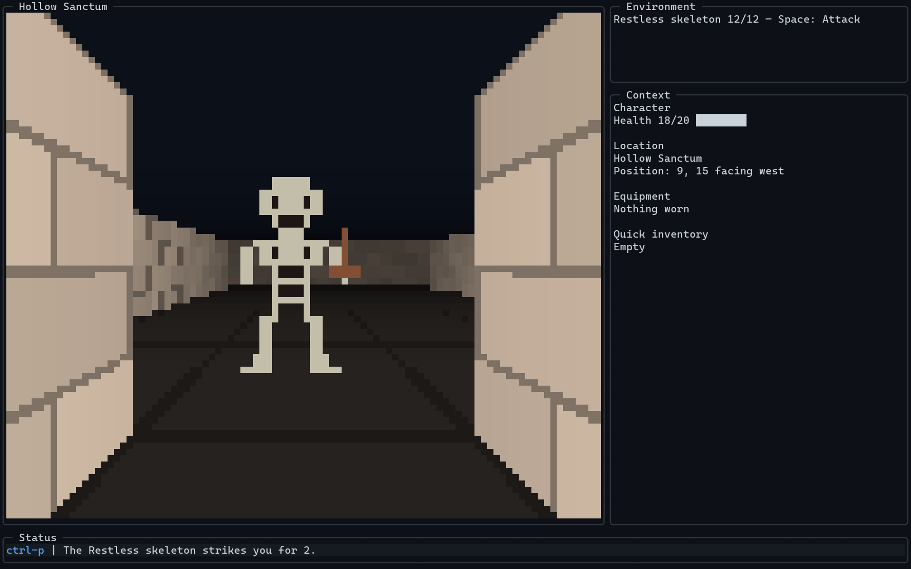
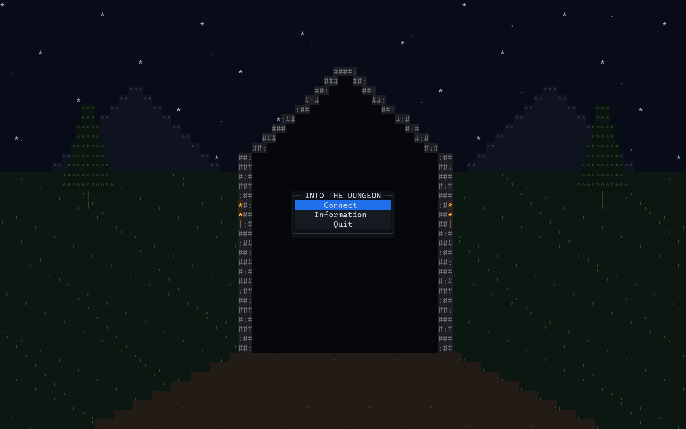
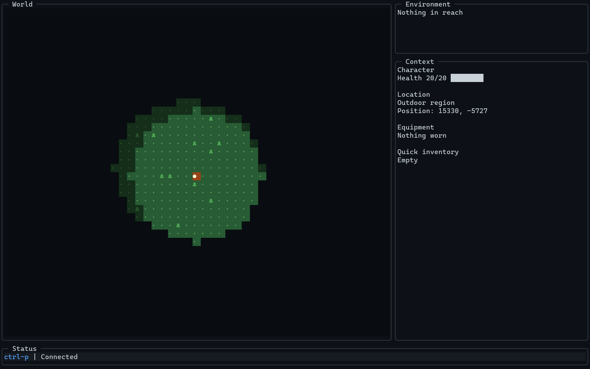
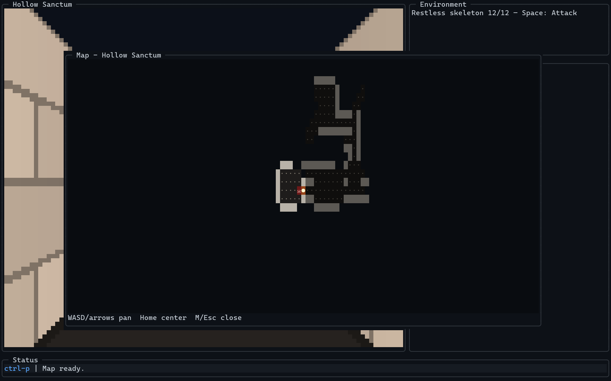
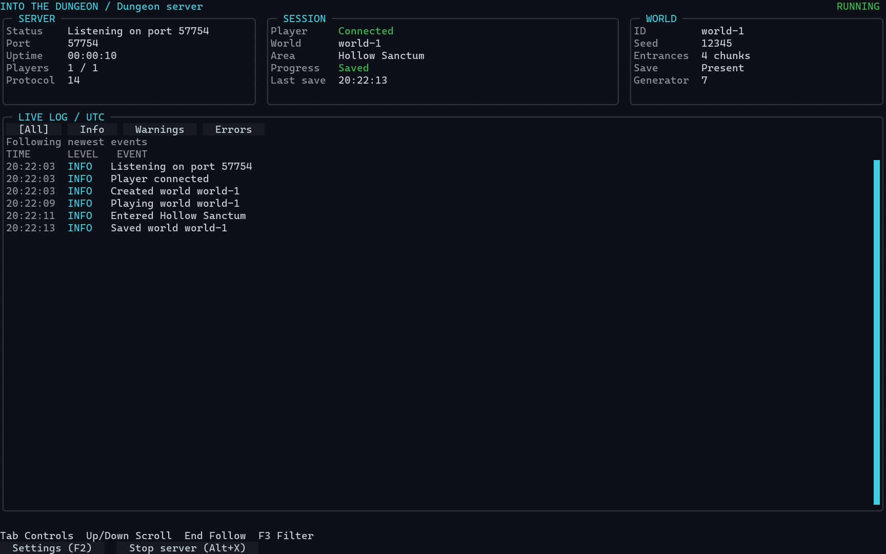

# Into the Dungeon

Explore a generated world, enter dungeons, and fight skeletons and giant rats — all in
your terminal. Into the Dungeon is a client-server role-playing game written in
[Functional Pascal](https://github.com/tobiasbick/functional-pascal).



The client renders a top-down outdoor map and a grid-based first-person dungeon
view. An authoritative server owns the world, movement, combat, and saves; it can
run headless or with a full-terminal dashboard.

> **Early development:** This is an experimental, vibe-coded hobby project, with
> no promise of a finished game. It also tests whether an LLM can build a VM-based
> programming language and use it for more than “Hello, world”. Developing the
> game exercises Functional Pascal's compiler, runtime, standard library, and
> tooling together.

## What you can play today

- Explore a seeded outdoor world with grassland, forests, water, mountains, and
  rare dungeon entrances. Movement across terrain chunks is seamless.
- Enter generated dungeons with rooms, corridors, and stored names. A dungeon's
  layout is fixed on first entry and retained when you revisit it.
- Visit Hearthmoor and talk to Mara. Her meeting state
  persists through explicit saves. Recover her lost compass from the deepest
  spawn-dungeon level for two Healing potions, and follow progress in the `J` journal.
- Find additional named villages with residents, guards, innkeepers and merchants. Their maps,
  NPC placements and independently remembered greetings persist through Save/Continue.
- Discover the world through Fog of War and open a pannable exploration map.
- Inspect and collect ancient coins, equip a rusty short sword and leather
  jerkin, find and use healing potions, and drop carried items.
- Sell loot for coins and buy individual goods from Elias in Hearthmoor or a
  village merchant. Stock is finite and independent; money and exact item
  ownership survive explicit saves. See [trade and economy](docs/architecture/economy.md).
- Fight restless skeletons and giant rats in turn-based combat, with health, armor, combat
  messages, and animations. Heal with potions or pay an innkeeper 5 coins for
  eight hours of rest and full health. Travel advances a persistent clock.
  Clear skies and rain follow that clock, with weather labels and map colors.
  Nights darken outdoor and village views. See [time and rest](docs/architecture/time-and-rest.md).
- Create separate worlds, continue a saved game, or start over in an existing
  world. Saves retain discovery, inventory, equipment, and visited dungeon state.
- Monitor the server through status panels, a live log, filters, and settings
  for new-world defaults and the global Gamemaster connection.

Each dungeon has three levels. Its entrance level has one skeleton, one giant
rat, four guaranteed floor finds and up to two optional finds; deeper levels
have more opponents. The server currently accepts **one connected player
at a time**.

## Quick start

You need a true-color terminal and a release build of
[Functional Pascal](https://github.com/tobiasbick/functional-pascal), with `fpas`
available on your command line. Use the compiler and source standard library
from the same FPAS checkout or installation. This checkout requires the native
typed standard-library errors, the `Error` generic constraint, `Result.MapError`
and `Std.Path.IsAbsolute`, plus `Std.Acp`, `Std.Mcp` and native executable builds.
The test fixtures also require the `Equatable` generic constraint. Older builds
without these APIs and language features cannot compile the full workspace.
The game remains under active development.

Run the following commands from the repository root, in **two terminals**.

First, start the server with its dashboard:

```powershell
fpas run apps/server/server.fpasprj -- --console
```

Then start the client:

```powershell
fpas run apps/client/client.fpasprj
```

If you built FPAS from source, you can select its matching library explicitly:
`fpas run --std-lib ../functional-pascal/lib apps/server/server.fpasprj -- --console`.
Use the same `--std-lib` option when starting the client.

1. Select **Connect** in the client. Both programs default to `127.0.0.1:4040`.
2. On a fresh installation, select **Create world**. Keep the creation defaults
   or choose a seed and entrance-region size.
3. Walk to the nearby dungeon entrance with **WASD**, then press **Enter**.
4. Explore, collect equipment, and use **Space** to attack the field ahead.
5. Open the system menu with **Ctrl+P** and choose **Save** before leaving.

**Continue** loads the selected world's explicit save, or starts at spawn if it
has no save yet. **Start over** resets the game in that world while retaining its
stored dungeon layouts and the previous save; replacing a save asks for
confirmation. **Choose world** returns to world selection and asks before
discarding unsaved progress. Quitting or stopping the server does not save
automatically.

To run the server without a dashboard, omit `--console`:

```powershell
fpas run apps/server/server.fpasprj
```

For the Gamemaster connection, see [Set up Pi](docs/setup/pi.md) for
Pi installation, local models and native MCP support. Connection and model
selection use **F2 -> Gamemaster settings**. The
[connection guide](docs/architecture/gamemaster-connection.md) also covers Codex.
An unconfigured server warns and continues listening.

## Controls

| Key | Action |
| --- | --- |
| WASD / arrows | Move on outdoor and settlement maps; WASD moves relative to facing in dungeons |
| Q / E | Turn left / right by 90 degrees inside a dungeon |
| Enter | Interact: inspect, pick up, use a gate/exit, or talk to an NPC |
| Space / Z | Attack ahead / wait one turn inside a dungeon |
| I | Inventory; Enter uses a consumable or wears/removes gear, D drops the selected item |
| C | Character sheet with health, equipment, and derived values |
| J | Quest journal; W/S, arrows and Page Up/Down scroll, Escape/J closes |
| M | Exploration map; WASD or arrows pan, Home centers, M or Esc closes |
| F2 / F3 | Toggle the client's context / message panels |
| Ctrl+P | System menu, including Save and Choose world |
| Alt+X | Quit |

In dungeons, successful steps, attacks, waiting, wearing/removing or dropping
items, and potion use advance a turn. A carried potion restores up to six health
points before the opponents act once. At full health the server rejects use
without consuming the potion or a turn. Turning, inspecting and rejected actions
do not advance time. The in-game system menu also lists the controls.

Hearthmoor's home gate is six steps from spawn. Inside the settlement, walk
beside Mara and press Enter to talk. W/S or arrows select a topic, Enter submits,
Escape ends the conversation, and Page Up/Down scrolls long text. Mara offers
the compass quest; Nora offers a confirmed 5-coin, eight-hour rest. End the conversation before saving; meeting state
persists only through an explicit save. Houses remain closed.

Generated villages use the same controls. Residents and guards explain their
village; innkeepers offer the same paid rest as Nora. Each NPC remembers its
own meetings. See the [village route](docs/architecture/generated-settlements.md#reproducible-acceptance)
for a new seed-25 world and ordinary routes to two villages.

## Screenshots

These images were captured before the final 14b contents at 144 × 45 terminal
cells; they illustrate that earlier version rather than every current item.
The gameplay images use a newly created world with seed `12345`, normal Fog of
War, and real server responses. Font appearance can vary between terminals.

### Start screen



The start menu sits inside a torch-lit entrance. Its colored ASCII scenery
adapts to the terminal size; connecting opens the world selection menu.

### Outdoor exploration



The player stands on the spawn region's dungeon entrance after the short walk
from spawn. Bright terrain is currently visible, darker terrain is remembered,
and black areas are undiscovered.

### Dungeon exploration map



Press **M** to inspect discovered rooms and corridors without moving the
character. The overlay retains the dungeon's stored name and hides unexplored
parts of the level.

### Server dashboard



The panels show listener status, connected players, the active world and dungeon,
and explicit-save status. Below them, the live log records real events from the
same session, including world creation, dungeon entry, and saving.

In the dashboard, **F2** opens settings, **F3** cycles log filters, **F4** opens
world administration, and **End** resumes following the latest entries. The
world list can permanently delete a confirmed complete world, including
incompatible data and its save, while no player is connected. **Tab** selects
controls; the focused log
supports arrows, PageUp/PageDown, and Home. See the
[server console guide](docs/product/server-console.md) for all controls.

## Worlds, settings, and compatibility

Runtime data defaults to `~/.fpas-into-the-dungeon/`. The programs create
`config/client.toml` and `config/server.toml` there; the server stores worlds,
immutable dungeon levels, and savegames under `worlds/`. Pass `--data-dir PATH`
to select a different data directory, or set `INTO_THE_DUNGEON_HOME`.

Both programs accept optional host and port arguments after `--`. The server's
`--world ID` preselects an **existing** world; startup never creates it. Create
new worlds through the connected client.

New-world seeds are signed 32-bit integers. Entrance regions can be 1 through
16 chunks wide. **Settings** in the dashboard changes creation defaults in
`server.toml`; existing worlds keep their original parameters. Each new world
gets its own identity, even when another world uses the same seed.

Worlds, levels, saves, and the protocol are versioned. The current versions are **world format 4**,
**generator 13**, **level format 4**, **settlement format 3**, **protocol 22** and **save format 15**.
Format-12 and older saves remain intact but cannot be continued with this server.
Generator-10 and older worlds remain on disk but
cannot be continued; create a new world for this version. Compatible worlds
can still be continued. Incompatible data is rejected without migration or
automatic deletion. Obsolete runtime configuration also produces an error
asking you to delete or recreate that configuration.

## Development and next steps

Generated dungeons (14a) and world management with the server dashboard (14s)
are complete. Dungeon contents (14b) was **accepted on 2026-10-16**: named dungeons now
naturally contain a skeleton, a giant rat, equipment and healing potions.
Optional floor finds keep stable original slot identities. Combat, storage,
protocol, rendering and inventory `I`/`Enter` potion use are implemented.
Storage tests now cover potion transfer between dungeons, terminal items,
explicit save/reopen/load, revisit, Start over and earlier-save rewind without
replacing level files. TCP tests also cover the complete contents loop, combat
art, reconnect before saving, Continue, old-data rejection and shutdown without
autosave. The
[persistence smoke measurements](docs/architecture/persistence-measurements.md)
cover 1/10/100 visited dungeons and explain the additional validation cost.
Independent review findings are corrected and the documentation is aligned.
Progression (13b) is complete and accepted: the character
trains Unarmed and Blades by the health its hits remove, up to level 5 each, and
the scrollable `C` sheet shows both skills; see
[progression](docs/architecture/progression.md). Multiple dungeon levels (14c)
are implemented, with paired stairs between three distinct areas. Client/server connection isolation and socket cleanup are verified.
Server preparation failures preserve the current session. Large inventories
keep selection and controls visible; quick summaries stay bounded. World-catalog
inspection is limited to the requested page and any selected
world outside it; Continue still fully validates the save and referenced levels.
Save and load failures retain their detailed causes in the server log while
client rejections stay sanitized. Viewport refreshes keep the exploration map
open and preserve its current projection and pending map request. The completed
client/server review also separates world-lifecycle responsibilities and
documents connection ownership and UI state contracts.
Hearthmoor and Mara are implemented in 15a. The first deterministic compass
quest (15b), accepted with server world administration on 2026-10-17, includes
explicit acceptance, remembered hand-in, two potion rewards
and a read-only journal; see [quests](docs/architecture/quests.md). Generated
settlements are implemented in 15c, with immutable definitions, complete saved
NPC rosters and natural TCP rest/restart coverage. Trade and economy (15d) are
accepted. Time and rest (15e) add the persistent clock, night colors and paid
inn recovery; see [time and rest](docs/architecture/time-and-rest.md).
Weather and Hearthmoor's quest recognition (15f) are implemented and verified
through delegated self-acceptance; see the [weather contract](docs/architecture/weather-and-world-response.md).
The first LLM integration stage, [16a: Gamemaster connection and model selection](docs/architecture/gamemaster-connection.md),
supports Codex and Pi through ACP with an explicit embedded MCP tool test. Later LLM
substages will define actual game-event jobs and generated content.
Building interiors and multiplayer remain later work.

See the [roadmap](docs/roadmap.md) for the current checkpoints.
The [architecture overview](docs/architecture/overview.md) explains
module ownership, and [world structure and views](docs/product/world-and-views.md)
defines the game's terms.

Run the checks with your matching FPAS compiler and standard library:

```powershell
fpas fmt --check apps libs tests tools
fpas check dungeon.fpasworkspace
fpas test --timeout 600 --jobs 1 dungeon.fpasworkspace
```

Current workspace test verification passes: **183/183 test programs**.
The workspace has 22 projects. Coverage includes game rules, deterministic generation,
storage, protocol validation, TUI rendering and input, and real TCP sessions.

To inspect generated terrain without starting a game server:

```powershell
fpas run tools/world-preview/world-preview.fpasprj -- terrain
fpas run tools/world-preview/world-preview.fpasprj -- continentalness
```

Contributions are described in [CONTRIBUTING.md](CONTRIBUTING.md). Functional
Pascal's [language documentation](https://github.com/tobiasbick/functional-pascal/tree/main/docs/pascal)
is the reference for the implementation.

## License

[BSD-3-Clause](LICENSE)
