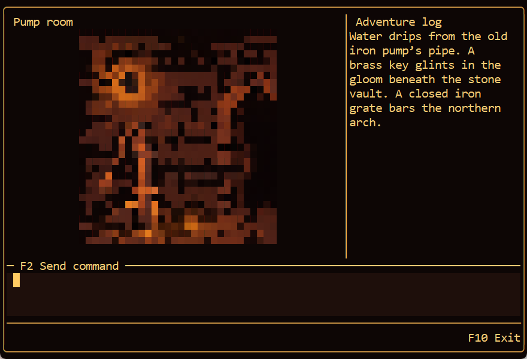

# Into the Dungeon

> **A note from the Human Overlord**
>
> Another try with the CLR version of Functional Pascal and an LLM as the
> game master. I'm still unsure about it. The first version had a client and
> server, an overworld, trading, and dungeons. That was too much for a first
> attempt.
>
> As always, I have no idea where this is going, whether I'll keep working
> on it, or whether I'll lose interest in a month or two.

Into the Dungeon is a small terminal adventure written in
[Functional Pascal](https://github.com/tobiasbick/functional-pascal). After forty silent years the shift bell rings beneath
the ember forest. Find the keeper who recognises its signal, follow the ferry
and the flooded railway, and decide what happens to the people below the dam.
The game master narrates the journey through 200 places in ten districts and
draws each room in two sizes of coloured Unicode art. **Continue** restores
your adventure and its drawings. Try “Turn over the smallest boots”, “What did
Iven tell me about the ferry?” or “How do I get back to Mara?” The game master
can look up what happened in your adventure and give directions along passages
you have explored.



## Quick start

Use a true-color terminal, the FPAS CLI, .NET 10, and an installed, signed-in ACP agent.
Place the matching FPAS SDK, workflow and UI packages in `.tmp/feed`.
[Local package setup](docs/plan/README.md#local-fpas-packages)

Run the game from the repository root.

```powershell
fpas run Dungeon.slnx
```

Press **F2** to send a command and **F10** to exit.
See [game settings](docs/plan/README.md#game-settings) for agent setup.

### Pi (ACP)

With Pi installed, add the `@openma/pi-acp` adapter so Pi can use the
game's MCP tools.

```powershell
npm install -g @openma/pi-acp
```

Make sure `openma-pi-acp` is on `PATH` and select **Pi (ACP)** in the game settings.

The game writes errors to `errors.log` beside `settings.json`. On Windows,
look in `%APPDATA%\into-the-dungeon\`. [Settings and diagnostics](docs/plan/README.md#diagnostics)

## License

[BSD-3-Clause](LICENSE)
